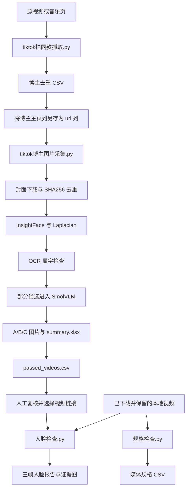

# TikTok 素材采集、封面初筛与视频质量检查：完整流程说明

本文依据本仓库实际 Python 代码整理，核对日期为 2026-11-02。仓库名为 `tt-ins-yt-media-cv-qc`；当前实现以 TikTok 和本地媒体检查为主，尚不包含 Instagram、YouTube 的专用采集实现。文中的“通过”均指对应规则通过，不代表全片或最终交付质量已经人工确认。

## 1. 项目解决的问题与实际边界

业务需要从公开视频或音乐页找到创作者，采集其帖子图片或视频封面，提前筛出人脸过小、模糊、明显叠字等素材，再对取得的视频检查交付规格和抽样帧人脸尺寸。人工逐条查看文件属性和画面的重复工作，被拆为可执行规则与可追溯报告。

本仓库包含三个可分别运行的阶段：

1. 来源发现：原视频／音乐页 → 去重后的博主与视频链接。
2. 静态图片初筛：博主列表 → 封面下载 → 人脸、清晰度、OCR、视觉模型分级 → 汇总表。
3. 视频检查：本地视频／TikTok 链接 → 文件规格检查或三帧人脸尺寸检查 → 报告与证据图。

这是脚本工具集合，不是一个命令自动调度所有步骤的系统。图片与视频使用不同模型、不同规则、不同报告；当前需要按下文操作衔接。



## 2. 文件结构和职责

```text
tt-ins-yt-media-cv-qc/
├── output_covers/                  # 本次合并保留的最后一轮结果
│   ├── <账号>/A_初筛通过、B_待人工复核、C_不合格/
│   ├── summary.xlsx
│   └── passed_videos.csv
├── profiles.csv                    # 原有博主输入，保留原样
├── README.md                       # 快速运行入口
├── 流程说明.md                      # 本文：结构、算法、数据流及限制
├── requirements.txt                # 图片完整流程依赖，含视频下载工具
├── tiktok拍同款抓取.py              # 独立发现入口，同时提供网络公共函数
├── tiktok博主图片采集.py            # 图片采集和 A/B/C 初筛主入口
├── tiktok封面水印筛选.py            # OCR/启发式模块，也可独立运行
├── vlm_overlay.py                  # SmolVLM 延迟加载及推理模块
├── 人脸检查.py              # 视频抽三帧，YuNet 人脸尺寸检查
├── 规格检查.py            # 视频/图片规格检查
├── test_video_qc.py                # 视频质检回归测试
├── VIDEO_QC_README.md              # 视频质检专项使用说明
└── docs/
    ├── 原流程说明_归档.md            # 旧说明，仅用于追溯，存在过时结论
    ├── 结果文件清单.json             # 67个原始结果文件的大小及SHA256
    └── 验证记录.md                  # 本次实际执行的检查及未验证部分
```

`output_covers` 当前是结果快照：55张 JPG、10张 PNG、1个 XLSX、1个 CSV，总计20,769,401字节。不是重新采集的结果，目录中的A/B/C是此前运行的机器判定。原始表格与图片保持字节一致；表格里的旧本地绝对路径可能仍指向原电脑，下载仓库后应以目录中的实际文件位置为准。

## 3. 环境、依赖与技术栈

| 层次 | 库或工具 | 实际用途 |
|---|---|---|
| 网络 | curl_cffi、requests | TikWM请求、Chrome请求特征模拟、图片下载、代理、超时和重试 |
| 浏览器 | Playwright、Chrome、CDP | 登录态复用、监听帖子接口响应、滚动音乐页 |
| 数据处理 | Python csv/json、OrderedDict、hashlib | 输入解析、稳定去重、断点记录、SHA256 |
| 并发 | ThreadPoolExecutor | 并发下载图片，不代表多模型并行推理 |
| 图像 | Pillow、OpenCV、NumPy | 图片校验、颜色空间、缩放、裁剪、Laplacian、边缘与连通域 |
| 图片人脸 | InsightFace buffalo_l、ONNX Runtime CPU | 定位人脸，选择最大检出框，计算局部清晰度 |
| OCR | rapidocr-onnxruntime | 找到文字框，结合颜色特征识别叠字 |
| 语义视觉 | PyTorch、Transformers、SmolVLM-500M-Instruct | 判断疑似贴纸、装饰文字、编辑叠加 |
| 视频 | FFmpeg、FFprobe | 抽帧、读取时长/编码/分辨率/平均帧率 |
| 视频人脸 | OpenCV FaceDetectorYN / YuNet | 对三个采样帧做轻量人脸框检测 |
| 链接下载 | yt-dlp | 下载TikTok视频至临时目录供人脸检查 |
| 报表与测试 | openpyxl、unittest、unittest.mock | Excel汇总、CSV输出、可控异常与中断测试 |

### 3.1 安装

在项目目录打开 PowerShell：

```powershell
python -m venv .venv
.\.venv\Scripts\Activate.ps1
python -m pip install -r requirements.txt
python -m playwright install chromium
ffmpeg -version
ffprobe -version
```

FFmpeg/FFprobe 是外部程序，不会因为安装Python依赖而自动就绪，应安装并加入PATH。实际浏览器代码指定 `channel="chrome"`，还需要本机Google Chrome；下载Playwright Chromium不能替代该项。InsightFace在某些Windows/Python版本上可能需要构建环境；依赖是版本下限清单，不是已锁定、跨平台验证过的环境。

本仓库统一使用 `opencv-python`。若只运行视频质检，可单独安装 `opencv-python-headless` 和 `yt-dlp`，不要在同一环境重复安装两种OpenCV发行包。

### 3.2 模型与缓存

- InsightFace首次使用下载/读取buffalo_l，代码指定CPUExecutionProvider。
- RapidOCR首次初始化读取其模型资源；初始化失败会切换为不可用状态。
- SmolVLM通过Hugging Face加载，CPU float32，模型由库缓存；首次加载可能明显慢于后续推理。
- YuNet首次运行下载到脚本旁 `.face_size_check/face_detection_yunet.onnx`；已有有效大小的文件则复用。
- 模型权重、Chrome会话、登录Cookies和环境目录不随Git仓库提交。复制代码不是复制完整运行环境。

### 3.3 代理与登录

`tiktok拍同款抓取.py` 的 `PROXY` 默认是 `http://127.0.0.1:7890`，图片主程序复用它。使用者需让该端口代理实际可用，或明确修改为自身配置。水印独立入口支持 `--proxy` / `--no-proxy`；主采集程序没有同名参数。CDP接管的Chrome使用浏览器本身的网络配置，与Python下载请求的代理配置是两条路径。

## 4. 第一步：发现音乐同款视频与博主

### 4.1 tiktok拍同款抓取.py 的结构

- 配置：`TIKWM`、`PROXY`、`PROFILE_DIR`、`TARGET_CREATORS=3000`。
- 解析：`parse_video_url()`校验TikTok域名与 `/@账号/video/ID`；`resolve_music_id()`从音乐URL或原视频API响应获得音乐ID。
- 网络：`_get_session()`按线程保存curl_cffi Session；`api_get()`统一代理、请求头、20秒超时、错误转为`ApiUnavailable`。
- API分页：`fetch_all_by_api()`请求`/music/posts`，每页30条，维护游标集合防止循环。
- 浏览器兜底：`find_music_url()`定位音乐页，`fetch_by_browser()`打开持久Chrome并滚动收集视频链接。
- 去重导出：`unique_creators()`按小写账号去重，保留每个博主首次出现的视频；`export_csv()`输出带时间戳CSV。
- 入口：`main()`执行API优先流程；`self_test()`可离线验证链接解析和去重。

```powershell
python .\tiktok拍同款抓取.py "https://www.tiktok.com/music/实际音乐名称-实际ID"
python .\tiktok拍同款抓取.py --self-test
```

API不可用时会切换到有头浏览器，需要时由用户完成登录或验证。浏览器最多滚动500轮，连续10轮无新增即停止；达到3000个不同博主也停止。3000是目标上限，不是已获取数量或必然完成的保证。API路径没有持久化断点；浏览器滚动期间Ctrl+C会保留已收集结果并导出。

导出列：`序号、视频链接、博主账号、博主主页、来源链接、抓取方式`。

### 4.2 与图片输入的衔接

图片主程序优先识别 `url、主页链接、profile_url、profile、link、链接`，不认识“博主主页”“视频链接”这两个导出列名。直接把拍同款CSV喂给图片主程序，可能选中第一列序号并把数字误当账号。

正确操作：把导出CSV中的“博主主页”列另存成单列CSV，表头命名为 `url`。例如：

```csv
url
https://www.tiktok.com/@实际账号
```

原有`profiles.csv`已经使用`url`表头。图片输入有表头；不要直接传无表头文本。优先使用CSV或XLSX，虽然分支写了`.xls`，openpyxl并不支持传统二进制XLS格式。

## 5. 第二步：采集封面并分级

### 5.1 推荐运行方式

在项目目录启动独立Chrome配置目录并登录TikTok：

```powershell
& "C:\Program Files\Google\Chrome\Application\chrome.exe" --remote-debugging-port=9222 --user-data-dir="$PWD\.tiktok_image_profile"
python .\tiktok博主图片采集.py profiles.csv --cdp --covers --max-covers 5 --output output_covers_new
```

先使用新输出目录`output_covers_new`，可保留仓库随附的最后一轮结果。确认登录后再运行主程序；脚本不会自动解决验证码。

| 参数 | 行为 |
|---|---|
| `input` | 带表头的CSV/XLSX |
| `--cdp [URL]` | 默认连接127.0.0.1:9222，并自动开启浏览器模式 |
| `--browser` | 自行启动持久Chrome的浏览器模式 |
| `--covers` | 浏览器分支采集视频封面；应和`--browser`或`--cdp`一起用 |
| `--max-covers` | 返回每账号最多N个帖子封面，默认5；不是“确保5张A级图” |
| `--concurrency` | 下载线程数，默认4；QC仍逐张执行 |
| `--limit` | 限制处理账号数；0为全部 |
| `--login` | 打开持久浏览器完成登录后退出，不执行采集 |
| `--output` | 输出根目录；默认脚本旁output |

仅加`--covers`不会启用浏览器，API分支仍按图文帖字段提取图片，不能当作正确的封面抓取用法。

### 5.2 tiktok博主图片采集.py 的结构

1. **模块装配**：`load_core()`用importlib动态加载中文文件名的拍同款脚本；`get_wm_module()`动态加载水印模块并缓存。
2. **输入处理**：`find_url_column()`定位列，`read_input()`读取，`parse_username()`提取账号，`main()`按小写账号去重并保留来源URL。
3. **来源获取**：`fetch_user_info()` / `fetch_user_posts()`处理API；`fetch_video_covers_browser()`处理封面；`fetch_photo_urls_browser()`为图文浏览器分支。
4. **下载**：`download_image()`重试请求、用Pillow校验内容，依据真实图片格式选择后缀。
5. **检测**：`qc_image()`汇总人脸、清晰度、水印、浮层等指标，按顺序给出A/B/C。
6. **账号编排**：`process_account()`组织任务、并发下载、SHA256去重、逐图QC、移动到等级目录、构造明细和账号统计。
7. **批次与报告**：`main()`合并历史记录、保存断点、定期写Excel；`write_excel()`生成三个工作表，最后导出A级视频清单。

### 5.3 浏览器采集机制

脚本打开博主主页，监听`/api/post/item_list`响应，从JSON中的`itemList`提取帖子ID、作者和封面URL。封面选择依次考虑`video.cover`、`originCover`、`dynamicCover`等字段。帖子ID用OrderedDict去重；默认等待页面6秒，再滚动3轮、每轮等待2秒，最后切片取`max_covers`。

实际封面分支只排除“作者存在且与目标不同”的条目；没有作者字段的条目仍可能被接收，不能宣称所有来源已严格验证。浏览器返回None时账号标记failed；返回空列表可能标记empty。图片主程序的浏览器失败不会自动回退API，虽然附近旧注释写过回退。

**图文浏览器分支现有缺陷**：`fetch_photo_urls_browser()`引用了局部不存在的`covers`和`max_covers`。回调可能吞掉异常，滚动循环也会报错，导致该分支不可可靠使用。本次整合保留原始采集代码并明确记录，未将其作为已验证能力。可用路径是上述`--cdp --covers`封面模式；图文API模式还受外部接口可用性限制。

### 5.4 下载、去重与落盘

每账号的图片任务先放进ThreadPoolExecutor。请求30秒超时，最多4次尝试；429/服务端错误或网络异常使用退避和随机等待。响应需要通过Pillow图片验证，然后按实际格式保存。下载结束后逐张QC，不是下载一张立即推理一张的流水线。

SHA256是文件字节级去重，范围为同账号保存的`seen_hashes`；不是全账号全局去重，也不是感知去重。重压缩或缩放后看起来一样的图可能哈希不同。重复文件会删除当前副本并记录C级“SHA256重复”；该条记录里的路径可能已不存在。

## 6. 封面质检算法与分级

### 6.1 图片解码与清晰度

Pillow完整读取图片，损坏直接C。OpenCV通过`np.fromfile + imdecode`读取，兼容中文路径。转灰度后计算`Laplacian(gray, CV_64F).var()`，记为整图`blur_score`。

Laplacian方差衡量局部高频变化，不是感知质量百分比；纹理、噪点、压缩、分辨率都会影响分数。阈值来自工程规则，不能跨场景宣称准确率。

### 6.2 InsightFace人脸检测

`get_face_app()`延迟加载buffalo_l，CPU运行，`det_size=(640,640)`。输入最长边超过1024时先缩小；检测框及关键点按比例映射回原始坐标。选择面积最大的检出框，记录框坐标、宽高、检测置信度，并在人脸裁剪区域计算局部Laplacian方差。

“最大框”仅是模型检出框中的最大者，不保证所有脸都被发现。人脸尺寸门槛宽高均128px。置信度不等于人脸清晰度，也不等于整图判定准确率。

### 6.3 实际判定顺序

| 顺序 | 条件 | 等级 |
|---|---|---|
| 1 | 图片损坏；或未检出人脸 | C |
| 2 | 最大检出人脸宽/高任一小于128 | C |
| 3 | 整图blur_score低于35 | C |
| 4 | 水印模块返回watermarked | C |
| 5 | 字幕/文字浮层检测命中 | C |
| 6 | 前述关卡通过后，SmolVLM回答包含yes | C |
| 7 | 疑似水印、人脸局部清晰度低于18、图片短边低于256，任一成立 | B |
| 8 | 无上述触发条件 | A |

代码会先算多项指标，再执行等级短路；只有VLM被明确放在前述关卡通过后执行。OCR可能被`detect_watermark()`内部和主程序单独重复调用，存在额外耗时。`filter_status`可记录“疑似滤镜/美颜”，但该标记没有进入最终B级条件；`logo_status`基本是保留字段，不能当作独立Logo识别结果。

### 6.4 模型故障与误判边界

现有图片模块对模型异常处理偏宽松：InsightFace失败可能被当作无人脸并判C；VLM不可用/推理失败返回False，调用方忽略原始回答，可能继续判A；OCR推理异常也可能被解释为未检出。必须检查终端WARN，不能把A理解为“全部模型成功且确认没有水印”。本次仅整合和说明现状，没有悄悄改变原采集分级规则。

## 7. tiktok封面水印筛选.py：OCR与启发式模块

### 7.1 结构

- `get_ocr()`：缓存RapidOCR实例，导入或初始化失败时标记不可用。
- `read_table()` / `find_cover_column()`：从表格寻找cover_url、封面链接、image_url等字段。
- `load_image()`：Pillow加载并转BGR。
- `detect_text_overlay()`：OCR文字框加颜色规则。
- `region_score()`：对角落/底部区域计算启发式分数。
- `detect_watermark()`：合并OCR结果和区域分数，返回status、score、region、details等。
- `collect_images()` / `download_image()`：读取本地图片或下载表格图片URL。
- `main()`：分类复制/移动及导出CSV。

### 7.2 OCR文字规则

OCR置信度须≥0.6，文字框宽高至少8px，框高占图高2%–30%。框内HSV满足：白色像素`V>195且S<60`占比>6%，深色像素`V<75`占比>5%，同时成立即命中叠字。

这只是“白字与深色背景/描边共存”的近似特征，没有真正分离文字描边。包装文字、招牌可能误报；彩色字幕、低对比水印、小文字可能漏报。不能使用旧说明中“不会误判”“稳定抓到所有字幕”等表述。

### 7.3 OCR可用与不可用的分支

`detect_watermark()`仍计算左下、右下、底部中央、右上、左上的区域分数。区域包含半透明白色比例、Canny边缘密度、形态学开运算、连通域文字带、灰色阴影比例等特征。

- OCR可用：最终状态仅由OCR叠字结果决定，命中watermarked，否则clean；即使角落分数很高也不直接使用。
- OCR不可用：使用区域分数，默认≥5为watermarked，≥3为suspect，否则clean；两个以上区域分数≥3时总分加1。
- `--threshold`和`--suspect`主要影响后者，不能当作所有模式统一的灵敏度旋钮。

`detect_floating_overlay()`仍存在，但调用已注释；`detect_text_overlay()`中的提前return之后还保留不可达旧启发式代码。两者都不是当前有效检测链，本次未删除这些已有代码。

### 7.4 独立运行

```powershell
python .\tiktok封面水印筛选.py "D:\待筛图片" --output "D:\筛选结果" --dry-run
```

默认复制到`clean/suspect/watermarked`；`--move`才移动原文件；`--dry-run`只生成报告和输出目录，不分类复制，但输入为表格URL时仍会下载图片。该入口不检查人脸，不调用VLM，不能代替主采集器完整QC。输出目录应放在输入目录之外，避免重跑时把上次结果再次纳入递归扫描。表格下载失败的条目目前可能不进入最终报告，应额外核对输入/成功数量。

## 8. vlm_overlay.py：本地语义视觉检测

`_state`保存processor、model、torch及是否尝试初始化；`_load()`只尝试一次加载。加载失败后本进程不会自动重试。`vlm_check(bgr)`返回`(是否命中, 原始回答)`。

模型为`HuggingFaceTB/SmolVLM-500M-Instruct`，CPU float32，输入最长边448，最多生成4个token，关闭采样。提示词要求区分编辑叠加内容与真实包装/衣服印字；回答包含`yes`就判命中。推理用锁串行保护，`torch.no_grad()`避免梯度开销。

解决的难题：无文字的商品贴纸无法仅靠OCR找到，因此补充语义判断。代价是CPU推理成本和模型误判。回答不是置信度，`no`或无法识别的回答不等于没有浮层。代码可返回`empty`、`model_unavailable`、`err:...`，但上层目前没有把这些作为强制复核条件。

## 9. 断点、统计和结果文件

图片采集运行时会生成：

- `checkpoints/checkpoint.json`：每账号done_posts和seen_hashes。
- `checkpoints/stats.json`：账号统计。
- `checkpoints/records.jsonl`：按账号、帖子ID、图片序号合并的明细。
- `summary.xlsx`：博主统计、图片明细、异常记录三个sheet。
- `passed_videos.csv`：A级记录的username、profile_url、video_url、local_path。

检查点在处理完一个账号后保存；Excel每5个账号及结束时写入，passed_videos在整个批次结束时导出。不是逐图片可靠事务，异常记录也没有完整跨批次保留机制。done_posts按帖子记录，多图帖子中有图成功、有图失败时，后续可能整帖跳过；写入失败被吞掉时也可能看不到持久化失败提示。删除检查点后不会从已有Excel反向恢复续跑状态。

本次随附的结果快照没有检查点文件，重跑到同一目录会重新处理部分数据；建议使用新目录。图片明细含来源URL、帖子URL、本地路径、图片尺寸、人脸框、整图模糊分和最终原因；`face_blur_score`参与评级，但没有写入现有Excel明细列。

## 10. 第三步：视频人脸尺寸检查

### 10.1 人脸检查.py 的结构与流程

- `require_tools()`检查FFmpeg、FFprobe与OpenCV。
- `ensure_model()`下载/复用YuNet模型。
- `get_duration()`用FFprobe读取有效、有限、正的视频时长。
- `extract_frame()`在10%、50%、90%位置输出JPEG。
- `detect_largest_face()`用FaceDetectorYN检测，选择最大框并写入标框证据图。
- `check_video()`合并三帧结论。
- `find_videos()`递归本地目录；`read_tiktok_links()`读取TXT/CSV链接并去重。
- `download_tiktok()`调用yt-dlp；`main()`按条目写CSV并汇总退出状态。

检测置信度阈值0.7，NMS阈值0.3，top_k=5000。人脸宽高四舍五入成整数后判断均≥128。没有模糊、遮挡、OCR、VLM环节，不能把图片QC能力套用到视频脚本。

三帧全达标为“合格”；任一帧检出人脸但尺寸不足为“不合格”；没有尺寸不足且存在未检出则“需复核”；运行异常为“处理失败”。图片模块将无脸判C，视频模块则保留人工复核，这两个口径有意分别记录。

### 10.2 运行及与A级清单衔接

```powershell
python .\人脸检查.py "D:\视频目录"
```

人脸脚本支持“视频链接”列；没有该列时扫描每行所有字段中的TikTok链接。原`passed_videos.csv`同时包含主页和视频URL，直接输入会把主页也列为下载任务，不能作为推荐用法。

**正确操作**：人工挑选A级记录后，把其中`video_url`列另存为单列CSV，表头改为“视频链接”，再执行：

```powershell
python .\人脸检查.py .\selected_videos.csv
```

实际使用请采用selected_videos方式，不要把原始passed_videos.csv直接传入。

URL模式视频下载到临时目录，批次退出时清理，留下报告和证据图。需要同时做完整规格检查时，应使用已保留的本地视频，对同一目录分别执行两个脚本；当前不会将临时下载视频自动传给规格脚本。

### 10.3 本次修复后的可靠性

规格读取/单次抽帧最多60秒，单视频下载最多300秒；模型下载设置60秒网络等待超时。每个视频完成后立即写CSV并flush；中断时已完成条目可读取，不等于断电级持久化或自动断点续跑。失败记录包含错误原因。

正常批次退出码：0全部合格；1有不合格或需复核；2有处理失败。启动阶段的工具/路径错误也会非零退出，查看终端具体原因。

## 11. 规格检查.py：媒体技术规格检查

该脚本只读取媒体，不转码、不放大、不插帧。Python标准库配合FFprobe完成视频检查；JPEG/PNG直接读取文件头。

- `parse_args()`接收待扫描目录。
- `read_image_info()`识别PNG IHDR/JPEG SOF尺寸；`check_image()`执行格式及短边检查。
- `parse_frame_rate()`用Fraction解析`24000/1001`等分数。
- `check_video()`获取首个视频流的编码、宽高、平均帧率与容器时长，缺失时回退流时长；逐项返回不通过原因。
- `main()`递归扫描受支持扩展名，逐文件写CSV，并输出计数和退出码。

| 检查项 | 当前标准 |
|---|---|
| 视频格式 | .mp4后缀且FFprobe格式列表包含mp4 |
| 编码 | h264或hevc（H.264/H.265） |
| 分辨率 | 短边≥720px，横竖屏同规则 |
| 平均帧率 | ≥24fps，23.976fps仍不通过 |
| 时长 | 5–60秒，含边界 |
| 图片格式 | JPEG/PNG真实文件头 |
| 图片尺寸 | 短边≥512px |

```powershell
python .\规格检查.py "D:\视频目录"
```

报告生成于输入目录，文件名含时间戳和微秒，列为文件、类型、结论、规格、不通过原因。退出码0全部通过；1含不通过或读取失败；2目录/工具错误或无媒体。

本次修复了0fps、0秒因条件短路而放行的问题；负数、缺失、NaN、Infinity等无效值也不会通过。FFprobe超时作为失败结果写出，不拖住整个批次。注意：它不逐帧解码整条视频，规格通过不保证没有损坏帧；文件头检查不等于完整图片质量评估；元数据也不能证明素材未被放大或插帧。

## 12. 遇到的技术难题、处理办法和取舍

| 难题 | 当前处理 | 仍需注意 |
|---|---|---|
| TikWM接口失败、403、登录限制 | 音乐采集API失败后浏览器兜底；封面可选CDP登录态 | 不保证接口长期稳定；封面分支没有自动兜底 |
| 推荐列表混入非目标博主 | 读取author并过滤不同账号 | 封面缺失作者仍可能接收，不能当作完全可靠归属 |
| 下载失败与速度 | 下载线程池、超时、退避、图片有效性校验 | 模型QC串行；更大并发不一定提高总吞吐 |
| 字幕与产品包装文字相似 | OCR文字框加白色/深色像素规则 | 没有真正识别“描边”，有误报与漏报 |
| 无文字贴纸无法OCR | 增加SmolVLM语义判断 | CPU耗时、模型失败漏放、未测业务准确率 |
| 原图缩放影响128px判断 | InsightFace检测后框映射回原始尺寸 | 检测框本身仍有误差 |
| 中文路径读图失败 | 视频和图片主流程使用字节读取再解码 | 部分旧模块fallback仍采用直接imread |
| 整批中断丢报告 | 视频脚本逐条写入和flush | 图片采集按账号落盘，可靠性不同 |
| 只凭“有脸”无法判断可用 | 加宽高阈值，图片另外计算模糊分 | 人脸可见、无遮挡、身份一致仍需人工判定 |
| 图文多图断点与历史统计 | 以帖子ID记录完成、合并历史明细重算A/B/C | 失败图片可能因整帖完成而跳过 |

以上来自当前代码和本次可复现验证。旧说明中的“25/65误报”“VLM准确率80–90%”“整个批次十几分钟”“唯一可行路线”等没有随附可核对实验，不作为本版结论。

## 13. 性能、验证与如何评估效果

本机此前对5个本地短视频单次实测：FFprobe规格读取约0.048–0.099秒/条，三帧抽取、YuNet和证据保存约0.286–1.073秒/条。样本包含2条生成素材及3条已有素材，不含网络下载、首次模型下载，不代表大规模吞吐或真人业务准确率。

本次合并不重跑65张图片的模型全流程、不发起TikTok批量网络采集，也不把已有等级当作人工真值。旧说明中VLM每张10–13秒仅作未复测历史描述；实际速度取决于硬件、线程、模型缓存、图片大小及进入VLM的比例。

推荐后续评测方法：固定一批覆盖正脸/侧脸/小脸/动画/模糊/包装文字/字幕/水印/贴纸的真实业务素材，人工标注每类问题；分别统计误拒、漏放、需复核比例；记录下载、人脸、OCR、VLM和报告耗时。模型检测置信度、A级比例均不能替代准确率。

效率提升要区分“同量素材耗时下降”与“单位时间处理量增加”，还需包括人工复核和返工时间。当前材料不能计算或证实30%效率提升。

## 14. 测试与排障

```powershell
python -m unittest test_video_qc -v
python .\tiktok拍同款抓取.py --self-test
python .\tiktok博主图片采集.py --help
python .\tiktok封面水印筛选.py --help
python .\人脸检查.py --help
python .\规格检查.py --help
```

| 现象 | 检查路径 |
|---|---|
| CDP连接失败 | Chrome是否按命令启动、9222端口是否正确、是否已有实例占用profile |
| API 403或代理错误 | 核实7890代理、外部接口；封面改用已登录CDP模式 |
| 总是empty | 登录/验证码、目标账号可访问性、是否拿到item_list响应 |
| 无有效账号 | 检查CSV表头，避免把序号列当账号；使用url列 |
| 全部C且无人脸 | 先看InsightFace WARN，排除模型初始化失败 |
| VLM WARN但仍出现A | 当前失败降级逻辑，必须人工复核；不要宣称视觉模型检查成功 |
| summary.xlsx无法写入 | 关闭Excel占用，再重新导出/运行；不要忽略保存异常 |
| 文件都存在但重跑重新下载 | 检查checkpoints是否存在；快照本身不能恢复断点 |
| 23.976fps不通过 | 目前标准严格≥24fps，不是读取错误 |
| 视频未检出人脸 | 查看三张证据图；不能直接认定完全无脸或有遮挡 |

## 15. 本次整合范围

保留4个原采集/图片检测脚本、profiles.csv以及65张图片和2份结果表；加入修复后的视频质检脚本、9项回归测试、专项说明。重写README和本流程说明，补充yt-dlp依赖、版本追溯清单和Git忽略规则。原始桌面目录未改动。

仍待另行实施：图文浏览器变量错误修复、统一CSV列名衔接、模型失败强制复核、逐图可靠断点、统一报告/流水线、真实业务标注评测。没有把这些待办描述成已完成功能。
